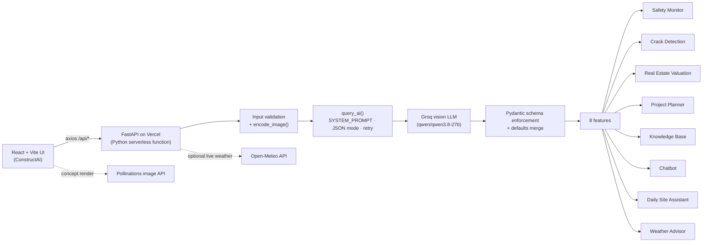
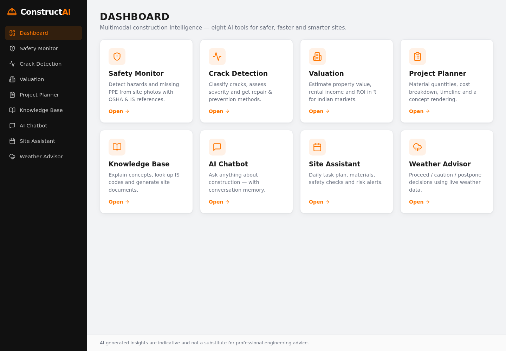
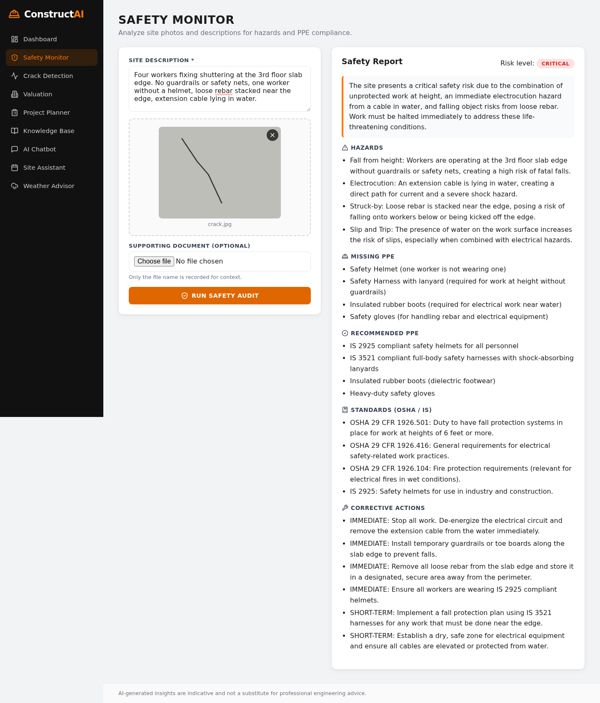
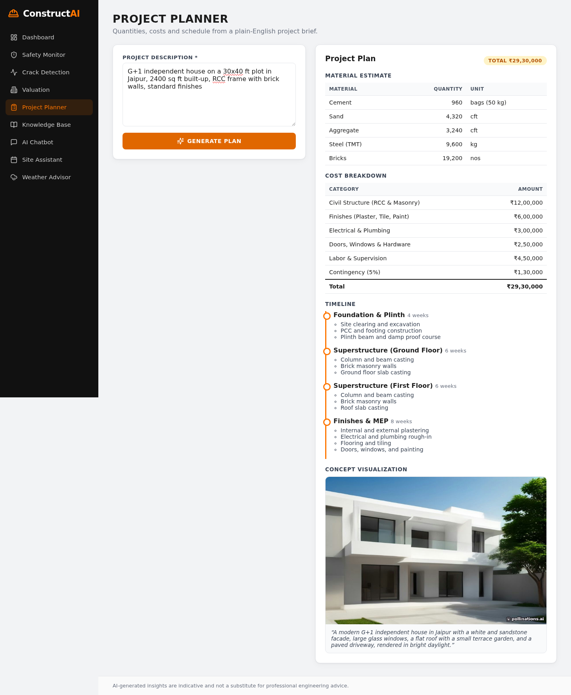
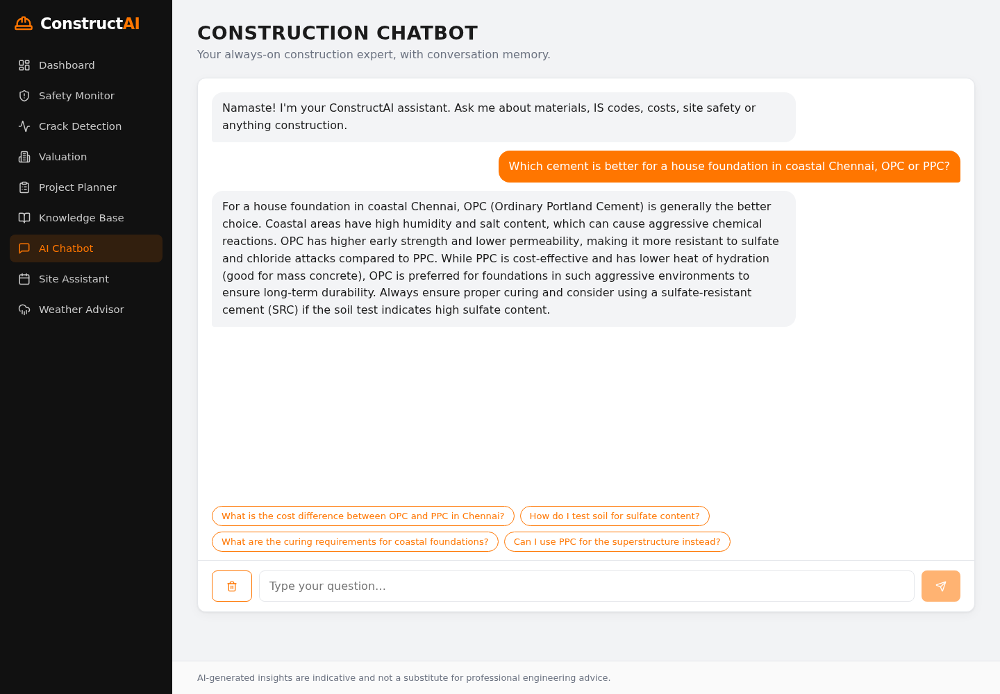

# ConstructAI — Multimodal Construction Intelligence Platform

**Live demo:** __LIVE_URL__
**GitHub:** https://github.com/SaumyaJain712/multimodal-construction-intelligence

ConstructAI is an AI-powered web platform for the Indian construction industry. Eight tools — safety
auditing from site photos, crack diagnosis, property valuation, project planning, a standards knowledge
base, a chatbot, a daily site assistant and a weather advisor — share one centralized multimodal AI layer
built on FastAPI and Groq. Every answer comes back as validated, schema-complete JSON, with money in ₹ and
references to Indian Standards (IS 456, IS 800, NBC 2016…) and OSHA where relevant.

> AI-generated insights are indicative and not a substitute for professional engineering advice.

## Architecture



## Features

| Module | What it does | Input |
|--------|-------------|-------|
| **Safety Monitor** | Risk level, hazards, missing/recommended PPE, OSHA 1926 + IS standards, corrective actions | Text + optional photo + optional document |
| **Crack Detection** | Crack type & severity, causes, risks, repair and prevention | Photo and/or text |
| **Real Estate Valuation** | Value range, ₹/sq ft, monthly rent, ROI, outlook | Location, area, type, age, amenities |
| **Project Planner** | Materials (cement, sand, aggregate, steel, bricks), cost table, timeline, AI concept render | Free-text brief |
| **Knowledge Base** | Explain concepts · IS codes & standards · generate site documents | Query + mode tab |
| **Construction Chatbot** | Conversational assistant with memory and suggestion chips | Chat |
| **Daily Site Assistant** | Tasks, materials & equipment, safety checks, risk alerts | Activity, labour count, site condition |
| **Weather Advisor** | PROCEED / PROCEED WITH CAUTION / POSTPONE with live Open-Meteo weather | Activity, weather, optional city |

**Reliability built in:** one system prompt with every schema, JSON mode, code-fence stripping, type
coercion (`"₹25,00,000"` → `2500000`), enum normalization, one automatic retry, and a full default
response plus a friendly `error` field if the model still fails — so the UI never crashes.

## Tech stack

- **Backend:** Python 3.12, FastAPI, Pydantic v2, python-multipart, python-dotenv, requests, Groq SDK, Pillow
- **Frontend:** React 18 + Vite 5, react-router-dom, axios, framer-motion, lucide-react, plain CSS variables
- **AI:** Groq — `qwen/qwen3.8-27b` (vision + JSON mode), configurable via `GROQ_MODEL`
- **Hosting:** a single Vercel project — static Vite build + FastAPI as a Python serverless function under `/api`
- **Testing:** pytest with a mocked Groq client

## Folder structure

```
.
├── api/index.py               # Vercel Python entry → from backend.main import app
├── backend/
│   ├── main.py                # FastAPI app, SYSTEM_PROMPT, encode_image(), query_ai(), endpoints, schemas
│   └── tests/test_api.py      # pytest suite (Groq mocked)
├── frontend/
│   ├── src/
│   │   ├── App.jsx            # Router, sidebar, dashboard
│   │   ├── api.js             # axios instance + helpers
│   │   ├── index.css          # Design tokens and styles
│   │   └── components/        # 8 feature modules + ErrorBoundary + shared UI
│   └── vite.config.js         # Dev proxy /api → localhost:8000
├── docs/
│   ├── REQUIREMENTS.md        # Functional / non-functional requirements and I/O formats
│   └── screenshots/
├── requirements.txt           # Backend runtime deps (installed by Vercel)
├── requirements-dev.txt       # + pytest, httpx, uvicorn
├── vercel.json
└── .env.example
```

## Local setup

Prerequisites: Python 3.10+, Node.js 18+, a [Groq API key](https://console.groq.com/keys).

```bash
# Backend
python -m venv venv
source venv/bin/activate            # Windows: venv\Scripts\activate
pip install -r requirements.txt     # use requirements-dev.txt to also get pytest
export GROQ_API_KEY=your_key_here   # or copy .env.example to .env
uvicorn backend.main:app --reload --port 8000

# Frontend (new terminal)
cd frontend
npm install
npm run dev                         # http://localhost:5173 — /api is proxied to :8000
```

## Environment variables

| Variable | Where | Description |
|----------|-------|-------------|
| `GROQ_API_KEY` | backend | Groq API key. Never commit it. |
| `GROQ_MODEL` | backend | Optional. Defaults to `qwen/qwen3.8-27b`. Must support vision + JSON mode. |
| `VITE_API_URL` | frontend (build time) | Optional API base URL. Empty = same-origin `/api`. |

## API reference

All AI endpoints return HTTP 200 with the full schema. If the AI step fails, the defaults are returned
with an extra `"error"` field. Invalid user input returns HTTP 400 `{ "detail": "..." }`.

| Method | Endpoint | Body |
|--------|----------|------|
| GET | `/api/health` | — |
| POST | `/api/safety-monitor` | form: `text`, `image?`, `document?` |
| POST | `/api/crack-detection` | form: `text`, `image?` |
| POST | `/api/real-estate-valuation` | form: `location`, `area`, `property_type`, `building_age`, `amenities` |
| POST | `/api/project-planner` | JSON: `description` |
| POST | `/api/knowledge-base` | JSON: `query`, `mode` |
| POST | `/api/chatbot` | JSON: `query`, `history[]` |
| POST | `/api/site-assistant` | JSON: `activity`, `labour_count`, `site_condition` |
| POST | `/api/weather-advisor` | JSON: `activity`, `weather`, `location?` |

<details>
<summary><strong>Sample requests and responses</strong></summary>

**Health**
```bash
curl https://<your-app>/api/health
```
```json
{ "status": "ok", "model": "qwen/qwen3.8-27b", "key_configured": true }
```

**Safety Monitor**
```bash
curl -X POST https://<your-app>/api/safety-monitor \
  -F "text=Workers fixing shuttering at 3rd floor slab edge, no guardrails, one without helmet" \
  -F "image=@site.jpg"
```
```json
{ "risk_level": "High", "hazards": ["Unprotected slab edge — fall from height"],
  "missing_ppe": ["Safety helmet", "Full-body harness"], "recommended_ppe": ["IS 2925 helmet", "IS 3521 harness"],
  "osha_standards": ["29 CFR 1926.501(b)(1)", "IS 3696 (Part 1)"],
  "corrective_actions": ["Stop work at edge until guardrails are installed"], "summary": "..." }
```

**Crack Detection**
```bash
curl -X POST https://<your-app>/api/crack-detection -F "text=2 mm diagonal crack from window corner" -F "image=@crack.jpg"
```
```json
{ "crack_type": "Diagonal", "severity": "Moderate", "probable_causes": ["Differential settlement"],
  "potential_risks": ["Progressive widening"], "repair_methods": ["Epoxy injection after monitoring"],
  "preventive_measures": ["Improve plinth drainage"], "summary": "..." }
```

**Real Estate Valuation**
```bash
curl -X POST https://<your-app>/api/real-estate-valuation \
  -F location="Baner, Pune" -F area=1200 -F property_type=Residential -F building_age=5 -F amenities="Gym, pool"
```
```json
{ "estimated_value_min": 10800000, "estimated_value_max": 12600000, "price_per_sqft": 9750,
  "rental_income_monthly": 32000, "roi_percent": 3.3, "appreciation_outlook": "Steady 6–8% annually...",
  "key_factors": ["IT-park proximity"], "currency": "INR", "disclaimer": "..." }
```

**Project Planner**
```bash
curl -X POST https://<your-app>/api/project-planner -H "Content-Type: application/json" \
  -d '{"description":"G+1 house, 1500 sq ft built-up, RCC frame, Pune"}'
```
```json
{ "materials": { "cement_bags": 600, "sand_cft": 2700, "aggregate_cft": 2025, "steel_kg": 6000, "bricks": 12000 },
  "cost_breakdown": [{ "category": "Structure (RCC)", "amount": 1100000 }], "total_cost": 3000000,
  "timeline": [{ "phase": "Foundation", "duration_weeks": 4, "tasks": ["Excavation", "PCC", "Footings"] }],
  "visualization_prompt": "Modern two-storey Indian house..." }
```

**Knowledge Base**
```bash
curl -X POST https://<your-app>/api/knowledge-base -H "Content-Type: application/json" \
  -d '{"query":"Minimum cover for columns","mode":"standards"}'
```
```json
{ "title": "Nominal Cover for Columns — IS 456:2000", "content": "...",
  "key_points": ["40 mm for columns (Cl. 26.4.2.1)"], "references": ["IS 456:2000 Cl. 26.4"] }
```

**Chatbot**
```bash
curl -X POST https://<your-app>/api/chatbot -H "Content-Type: application/json" \
  -d '{"query":"Which concrete grade for an RCC slab?","history":[]}'
```
```json
{ "reply": "For residential RCC slabs, M25 is the common choice...",
  "action_suggestions": ["What are the curing requirements for M25?"] }
```

**Daily Site Assistant**
```bash
curl -X POST https://<your-app>/api/site-assistant -H "Content-Type: application/json" \
  -d '{"activity":"First floor slab casting","labour_count":18,"site_condition":"Muddy access road"}'
```
```json
{ "tasks": ["06:00 toolbox talk..."], "materials_equipment": ["Needle vibrator"],
  "safety_checks": ["Helmets (IS 2925) for all"], "risk_alerts": ["Cold joints if supply is interrupted"] }
```

**Weather Advisor**
```bash
curl -X POST https://<your-app>/api/weather-advisor -H "Content-Type: application/json" \
  -d '{"activity":"Roof slab concreting","weather":"Rainy","location":"Mumbai"}'
```
```json
{ "decision": "POSTPONE", "identified_risks": ["Washout of cement paste"], "precautions": ["Keep tarpaulins ready"],
  "mitigation_steps": ["Reschedule to a dry window"], "live_weather": "Mumbai, India: 28.4°C, humidity 84%..." }
```
</details>

## Testing

```bash
pip install -r requirements-dev.txt
pytest -q backend/tests
```

The suite mocks the Groq client and covers: complete schemas for all 8 endpoints, partial AI output filled
with defaults, image + document upload, no image, wrong file type, corrupt image, oversized image,
empty/whitespace text, `labour_count` sent as a string, invalid enums, malformed AI JSON (retry then
defaults), fenced JSON and wrong types coerced, Groq exceptions → 200 + `error`, model-not-found message,
missing API key, live-weather success and failure, and chat history forwarding.

Frontend build check: `cd frontend && npm run build`.

## Screenshots

| Dashboard | Safety Monitor |
|-----------|----------------|
|  |  |

| Project Planner | Chatbot |
|-----------------|---------|
|  |  |

## Known limitations

- Estimates (costs, valuations, quantities) come from an LLM using thumb rules and general market
  knowledge; they are indicative, not engineered or certified values.
- Image analysis quality depends on photo clarity; the model cannot measure crack widths precisely.
- Vercel limits request bodies to 4.5 MB, so images are capped at 4 MB and supporting documents are
  recorded by filename only (their content is not parsed).
- No authentication, persistence or per-user history; chat history lives in the browser tab.
- Concept renders rely on the free Pollinations service and may be slow or unavailable.
- The free Groq tier is rate-limited; heavy use may return a friendly "busy" error.

## Future enhancements

- PDF/DOCX parsing for safety documents and drawings; BOQ export to Excel.
- User accounts and saved projects with a database.
- Fine-grained crack segmentation with a dedicated CV model.
- Live market data feeds for material prices and property rates.
- Multilingual UI (Hindi and regional languages) and voice input on site.
- Streaming responses for the chatbot.

## Deployment (Vercel)

The repo deploys as one Vercel project: `vercel.json` builds `frontend/` into `frontend/dist`, routes
`/api/*` to the FastAPI app in `api/index.py`, and falls back to `index.html` for client-side routes.

```bash
vercel link --yes
printf "%s" "$GROQ_API_KEY" | vercel env add GROQ_API_KEY production
printf "%s" "qwen/qwen3.8-27b" | vercel env add GROQ_MODEL production
vercel --prod --yes
```

Then verify:

```bash
curl https://<your-app>/api/health        # key_configured: true
curl -I https://<your-app>/safety         # 200 (SPA fallback)
```
